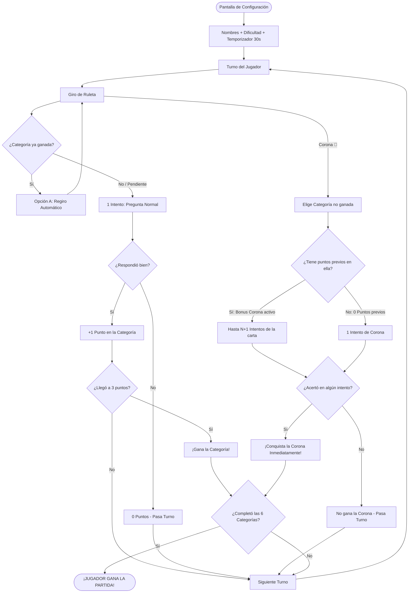

# Plan de Diseño y Reglas del Juego: **pregunta2**

---

## 1. Visión General del Proyecto

**pregunta2** es un juego de mesa interactivo de preguntas y respuestas para **2 jugadores** en modalidad *Hotseat* (ambos juegan por turnos compartiendo la misma computadora). El objetivo es poner a prueba el conocimiento en seis áreas del saber y la cultura general, sumando puntos y coronándose como el campeón al conquistar las seis categorías.



---

## 2. Configuración Previa de Partida (Lobby de Ajustes)

Antes de iniciar la partida, los jugadores acceden a un panel de configuración donde determinan las condiciones del juego:

1. **Registro de Jugadores**:
   - Nombre de **Jugador 1** y **Jugador 2**.
   - Asignación de avatar o color identificador.
2. **Selector de Dificultad de Preguntas**:
   - 🟢 **Fácil**: Preguntas directas de cultura general, conceptos básicos y opciones con menor ambigüedad.
   - 🟡 **Media (Equilibrada)**: Preguntas de conocimiento estándar con distractores equilibrados.
   - 🔴 **Difícil**: Preguntas con mayor profundidad técnica, fechas exactas, autores menos conocidos y detalles minuciosos.
   - 🎲 **Mixta / Aleatoria**: Baraja dinámicamente cartas y preguntas de los tres niveles de dificultad.
3. **Temporizador de Turno**:
   - Fijado reglamentariamente en **30 segundos** por pregunta.
   - Cuenta regresiva visual (barra que cambia de color verde → amarillo → rojo) con alerta acústica en los últimos 5 segundos.
   - Si el temporizador llega a `0:00`, se considera respuesta fallida.

---

## 3. Las 6 Categorías Oficiales

Cada categoría cuenta con una identidad visual, color característico y temática definida:

| # | Categoría | Color Distintivo | Temática Principal |
|---|---|---|---|
| 1 | **Arte y Literatura** | 🔴 Rojo / Burdeos | Obras clásicas, autores, pintura, escultura, poesía y teatro |
| 2 | **Geografía** | 🔵 Azul Oceánico | Países, capitales, banderas, ríos, accidentes geográficos y mapas |
| 3 | **Ciencias y Tecnología** | 🟢 Verde Esmeralda | Física, química, biología, astronomía, computación e inventos |
| 4 | **Deportes** | 🟠 Naranja | Fútbol, baloncesto, tenis, olimpismo, récords y deportistas |
| 5 | **Entretenimiento** | 🟣 Magenta / Rosa | Cine, series, música, videojuegos, anime y televisión |
| 6 | **Historia** | 🟡 Amarillo Dorado | Edades históricas, batallas, civilizaciones antiguas y personajes históricos |

---

## 4. Estructura de Cartas y Banco de Preguntas

1. **Mazo por Categoría y Dificultad**:
   - Cada categoría posee mazos clasificados por nivel de dificultad (`facil`, `media`, `dificil`).
2. **Composición de cada Carta**:
   - **1 Carta = 3 Preguntas** distintas de la misma categoría y dificultad seleccionada.
   - **4 Opciones por Pregunta**: 3 distractores y exactamente **1 respuesta correcta**.
3. **Mecánica de extracción**:
   - Se roba una carta no utilizada de la categoría que indique la ruleta.
   - Las 3 preguntas de la carta se emplean según la cantidad de intentos que el jugador tenga disponibles por su **Bonus por Puntos Acumulados**.

### Estructura de Datos (JSON Schema con Dificultad)
```json
{
  "categoria": "CIENCIAS Y TECNOLOGIA",
  "dificultad": "media",
  "carta_id": "CT-MED-001",
  "preguntas": [
    {
      "id": 1,
      "enunciado": "¿Cuál es el elemento químico más abundante en el universo?",
      "opciones": ["Oxígeno", "Hidrógeno", "Helio", "Carbono"],
      "respuesta_correcta": 1
    },
    {
      "id": 2,
      "enunciado": "¿Qué científico propuso la teoría de la relatividad general?",
      "opciones": ["Isaac Newton", "Niels Bohr", "Albert Einstein", "Stephen Hawking"],
      "respuesta_correcta": 2
    },
    {
      "id": 3,
      "enunciado": "¿Cómo se llama la partícula subatómica con carga eléctrica negativa?",
      "opciones": ["Electrón", "Protón", "Neutrón", "Positrón"],
      "respuesta_correcta": 0
    }
  ]
}
```

### 4.1 Sistema de Gran Variedad y Algoritmo Anti-Repetición
Para garantizar que las partidas sean dinámicas, con preguntas ricas y variadas, y evitar que se repitan:

1. **Banco Extenso y Temáticas Diversas**:
   - Cada una de las 6 categorías cuenta con un amplio volumen de cartas distribuidas entre las distintas dificultades (`fácil`, `media`, `difícil`), cubriendo múltiples ramas del conocimiento.
2. **Mazo Barajado sin Reemplazo (Fisher-Yates)**:
   - Al inicio de la partida, los mazos de cada categoría se barajan aleatoriamente.
   - Toda carta y pregunta que entre en juego se traslada inmediatamente a una **Pila de Descarte**.
   - **Garantía Anti-Repetición**: Queda estrictamente bloqueada la reaparición de cualquier pregunta ya mostrada durante toda la partida activa.
3. **Control de Preguntas Jugadas en Sesión**:
   - El sistema almacena los identificadores (`carta_id` e `id`) de las preguntas utilizadas en el almacenamiento local de la sesión, de modo que si los jugadores inician una revancha rápida, se priorizan las cartas que aún no han salido.
4. **Ciclo de Rebarajado Seguro**:
   - Solo si en una partida extremadamente larga se agotaran todas las cartas de una categoría, la pila de descarte vuelve a barajarse por completo, asegurando que pase el mayor número de turnos posible antes de que una pregunta pueda volver a verse.

---

## 5. La Ruleta y Dinámica de Giro

La ruleta interactiva se divide en **7 secciones radiales**:
- **6 secciones de Categoría**.
- **1 sección de Corona Especial 👑**.

### Reglas de la Ruleta:
- **Giro Aleatorio**: Aceleración y deceleración física con indicador de parada.
- **Regla Oficial - Categoría ya Ganada (Opción A)**:
  - Si la ruleta se detiene en una categoría que el jugador activo **ya ha ganado**, el sistema muestra el aviso: *"¡Ya tienes esta categoría ganada! La ruleta vuelve a girar automáticamente..."* y realiza un nuevo giro sin penalización hasta caer en una categoría pendiente o en la Corona.
- **Casilla de Corona 👑**: Permite al jugador elegir manualmente cualquier categoría pendiente para intentar ganarla de forma directa.

---

## 6. El Anotador y Puntuación

### Tablero Anotador (Scoreboard):
Se visualiza en todo momento en pantalla para ambos jugadores:
- **Medallero de Coronas**: 6 insignias correspondientes a las categorías (se iluminan al ser conquistadas).
- **Barra de Puntos por Categoría (0 a 3)**:
  - `0 / 3`: Sin puntos acumulados (1 intento estándar).
  - `1 / 3`: 1 punto acumulado (Activa Bonus: hasta 2 intentos).
  - `2 / 3`: 2 puntos acumulados (Activa Bonus: hasta 3 intentos).
  - `3 / 3`: **¡Categoría Conquistada!** Se otorga la medalla de la categoría y queda sellada.

---

## 7. Dinámica de Turnos y Regla de Bonus

### A. Turno de Categoría Ordinaria:
1. Gira la ruleta y cae en una categoría pendiente.
2. Dinámica de juego de mesa: el rival actúa como lector con la respuesta correcta señalada.
3. El jugador dispone de **1 único intento** (Pregunta 1 de la carta):
   - **Acierto**: Suma **+1 punto** en esa categoría. Al alcanzar **3/3 puntos**, conquista la categoría.
   - **Fallo**: 0 puntos y termina el turno. En turnos ordinarios no hay reintentos de bonus.

### B. Turno de Corona 👑 (¡Activación del Bonus!):
1. La ruleta se detiene en la **Corona 👑**.
2. El jugador elige en pantalla qué categoría pendiente desea disputar.
3. **Cálculo de Intentos por Puntos Acumulados (Regla de Bonus en Corona)**:
   - **0 Puntos previos en la categoría**: El jugador dispone de **1 intento** (Pregunta 1 de la carta).
   - **1 Punto previo en la categoría**: ¡Bonus Activo! Dispone de **hasta 2 intentos** (si falla la Pregunta 1, el rival le lee la Pregunta 2).
   - **2 Puntos previos en la categoría**: ¡Bonus Activo! Dispone de **hasta 3 intentos** (Preguntas 1, 2 y 3).
4. **Resultado**:
   - **Acierto en cualquiera de los intentos**: Conquista la categoría y su medalla **directamente**.
   - **Fallo en todos los intentos disponibles**: No gana la corona en este turno (conserva sus puntos acumulados intactos) y pasa el turno.

---

## 8. Tabla Resumen: Sistema de Oportunidades y Bonus en Corona 👑

| Puntos Previos en la Categoría | Tipo de Turno | Oportunidades / Preguntas Máx. | Condición para Ganar Corona Directa |
|:---:|:---:|:---:|---|
| **Cualquiera (0, 1 o 2 pts)** | Turno Normal | **1 pregunta** | Acertar (+1 punto ordinario hacia 3/3) |
| **0 Puntos** | Desafío de Corona 👑 | **1 pregunta** | Acertar Pregunta 1 |
| **1 Punto** | Desafío de Corona 👑 | **Hasta 2 preguntas** (Bonus x2) | Acertar Pregunta 1 o Pregunta 2 |
| **2 Puntos** | Desafío de Corona 👑 | **Hasta 3 preguntas** (Bonus x3) | Acertar cualquiera de las 3 preguntas (1, 2 o 3) |

---

## 9. Condición de Victoria

- El primer jugador en conseguir las **6 categorías** (ya sea acumulando 3 puntos en cada una o mediante el desafío directo de la Corona) es proclamado **¡Campeón de pregunta2!**
- Pantalla final con resumen estadístico de la partida:
  - Tiempo total de juego.
  - Porcentaje de aciertos de cada jugador por categoría.
  - Preguntas respondidas con éxito bajo presión de tiempo.

---

## 10. Especificación Técnica de Implementación

- **Frontend**: Interfaz gráfica moderna, responsiva y temática para navegador local.
- **Ruleta**: Renderizado Canvas HTML5 o SVG con física de frenado y detección exacta de casilla.
- **Temporizador**: Módulo de tiempo en milisegundos con sincronización precisa (`requestAnimationFrame` o `setInterval` compensado) para evitar desfases.
- **Banco de Preguntas**: Archivo `preguntas.json` ordenado por categoría y dificultad (`facil`, `media`, `dificil`), garantizando un mínimo de 3 preguntas por carta.
- **Persistencia y Respaldo**: Almacenamiento local mediante `localStorage` para permitir reanudar partidas accidentadas.
